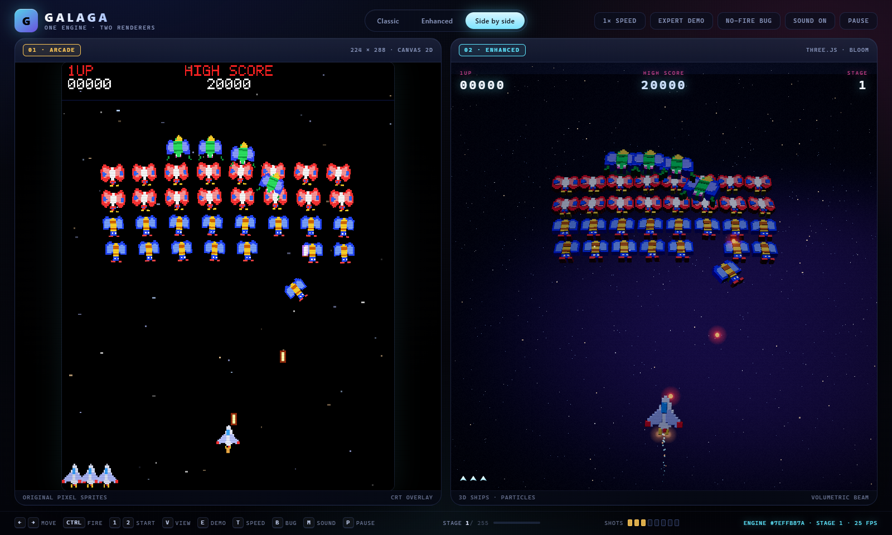
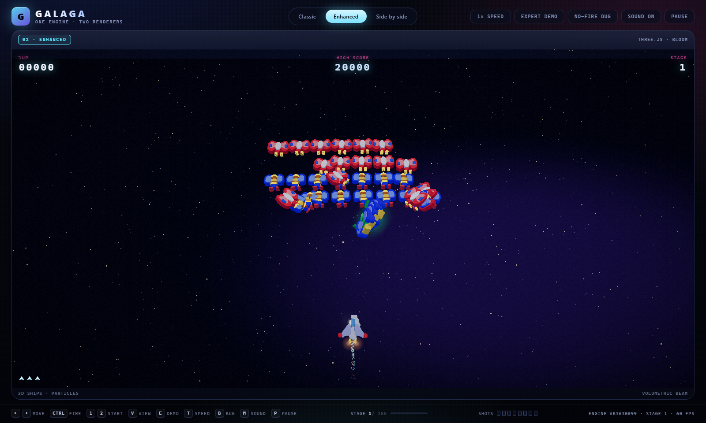
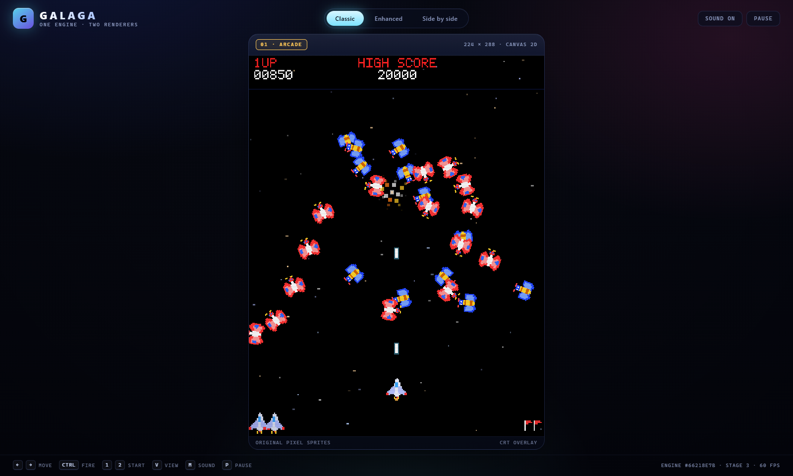
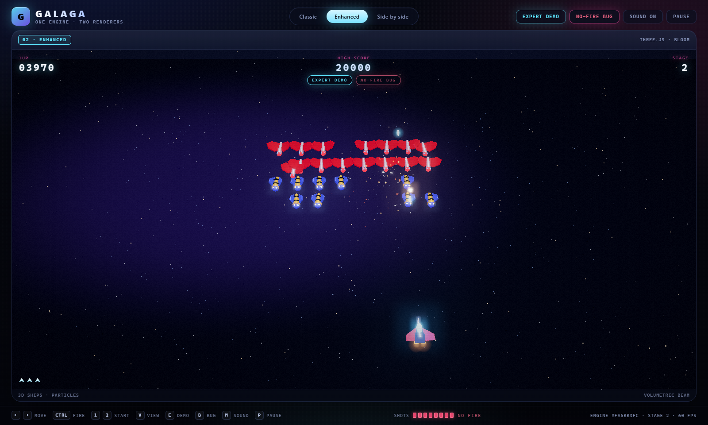
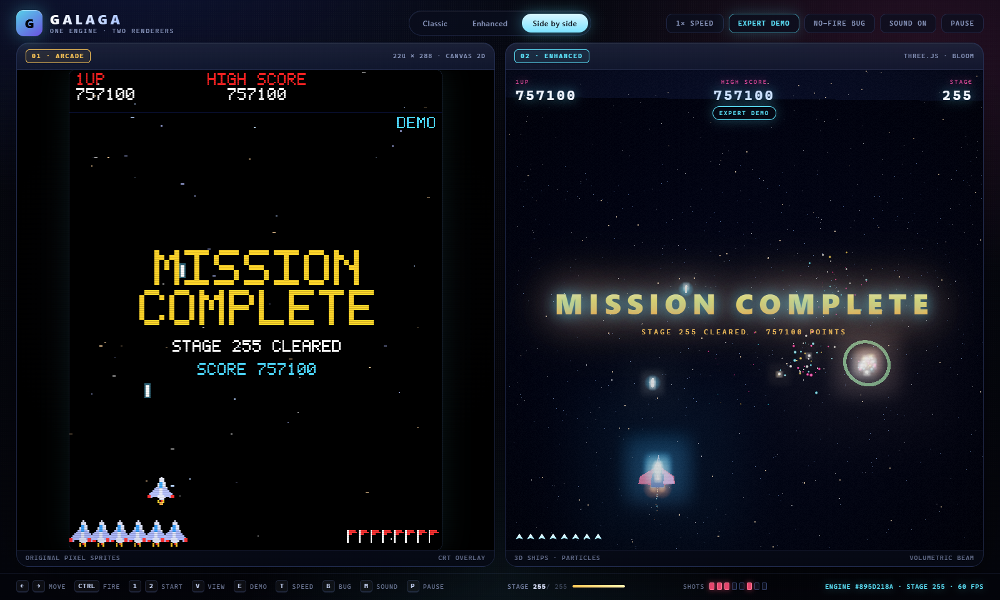
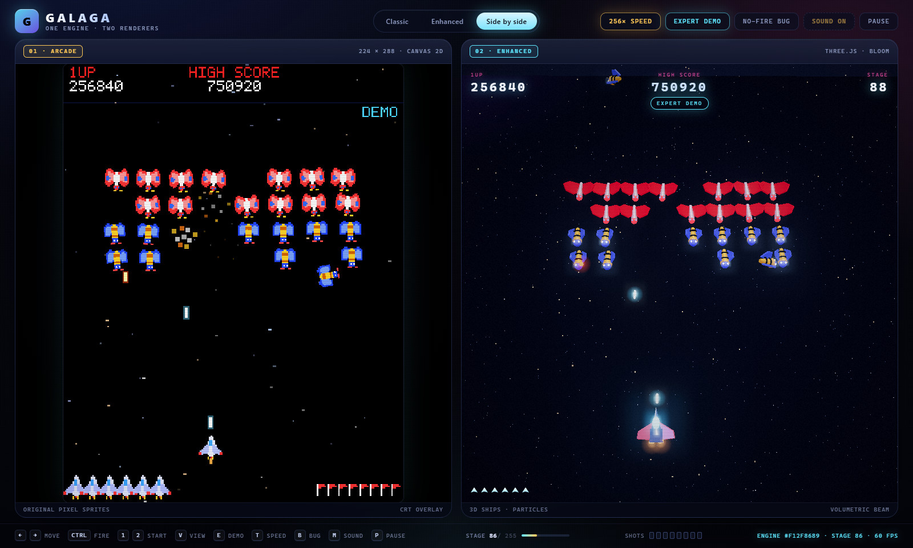

# GALAGA — one engine, two renderers

A from-scratch Galaga reimplementation with an unusual guarantee: the authentic
pixel-art version and the 3D enhanced version are not two games that look alike.
They are **one simulation drawn twice**.

In side-by-side mode both panes read the same `GalagaEngine` object on the same
frame, so an enemy that dives on the left is at exactly that position on the
right, down to the sub-pixel.



**Live:** <https://galaga-redux.kindof-lame.workers.dev> — deployed as the
Cloudflare Worker `galaga-redux`.
**Source:** <https://github.com/bnemetchek2/galaga-redux>.

## What it does

Three view modes, switchable at any time without interrupting play:

| Mode | What you see |
| --- | --- |
| **Classic** | A 224×288 arcade framebuffer: hand-authored pixel sprites, bitmap font, CRT scanlines, starfield. |
| **Enhanced** | The same coordinates rendered as a lit Three.js scene: 3D ship models with a baked environment map, engine trails, volumetric tractor beam, GPU particles, bloom, shockwaves, camera parallax and shake. |
| **Side by side** | Both at once, sharing one engine instance. |




## Run it

```powershell
# one-time
npm install --ignore-scripts

# build (typecheck + compile + stage static assets)
npm run build

# serve on http://127.0.0.1:4173
npm run serve
```

There is no bundler by design: TypeScript compiles straight to native ES modules,
`three` is vendored into `dist/vendor`, and `tools/serve.mjs` is a 50-line static
server. That keeps the build transparent and dependency-light.

```powershell
npm test          # 26 engine/pilot tests, including cross-run determinism
npm run typecheck # tsc --noEmit
```

## Deploy

The site is a Cloudflare Worker with static assets (`wrangler.jsonc`, worker name
`galaga-redux`). Cloudflare lowercases worker names, so `Galaga-redux` is
deployed as **galaga-redux**.

```powershell
npm run cf:whoami   # confirm the Cloudflare session
npm run deploy      # build + upload
```

`npm run deploy` runs `tools/deploy.ps1`, which builds the site and then uploads
`dist/` to the worker. It needs either a Wrangler login (`npx wrangler login`) or
a `CLOUDFLARE_API_TOKEN` with **Workers Scripts:Edit** and **Account:Read**.
`dist/.assetsignore` keeps compiled tests and source maps out of the upload.

The deployed site lives at:

```
https://galaga-redux.kindof-lame.workers.dev
```

Worker: `galaga-redux` · account `Bnemetchek@gmail.com's Account` · assets served
from `dist/`.

### Source

The repository is at <https://github.com/bnemetchek2/galaga-redux> (branch
`main`). `tools/create-github-repo.mjs` creates it through the GitHub API when
`GH_TOKEN` is set; ordinary `git push` then uses the machine's credential
manager. `tools/verify-github.mjs` checks what actually landed on the remote.


## Controls

| Key | Action |
| --- | --- |
| `←` `→` (or `A` `D`) | Move |
| `Ctrl` (or `Space` / `Z`) | Fire |
| `1` / `2` | Start a one- or two-player game |
| `0` | Insert a credit (cosmetic; starting a game works directly) |
| `V` | Cycle Classic → Side by side → Enhanced |
| `T` | **Simulation speed** — 1× → 4× → 16× → 64× → 256× |
| `E` | **Expert demo** — hand the controls to the autopilot |
| `B` | **No-fire bug** — jam every enemy shot slot |
| `M` | Mute / unmute |
| `P` or `Esc` | Pause |

Touch devices get on-screen start, move and fire buttons.

## Cheats and demonstrations

### The no-fire bug

Galaga stores enemy fire in **eight shared shot slots**. A shot created while a
ship is at the very edge of the screen is dropped at X=0 — and the routine that
moves bullets treats X=0 as "unused sprite", while the routine that frees slots
only looks at Y. The shot therefore never moves and never leaves its slot. Enough
of those and the fleet cannot fire at all for the rest of the credit.

The real thing takes about fifteen minutes of dodging two edge bees. Here you can
have it immediately: press `B` (or the **No-fire bug** button). The engine models
the actual mechanism, not a "mute the enemies" switch:

* every enemy shot occupies one of eight slots, so at most eight are in flight;
* a shot fired from within a few pixels of the screen edge has a chance to be
  dropped at X=0 and jam its slot permanently;
* with fewer than seven ships left the fleet uses its wide end-game sweep, which
  is what drags edge ships to X=0 — so the bug can also happen on its own during
  a long, patient game;
* the status bar shows all eight slots live, so you can watch them jam one by one.



### Expert demo

Press `E` (or **Expert demo**) and a hand-written expert pilot takes the controls
and plays real games back to back, restarting after each loss. It reads the same
state a player sees and can only press left, right and fire — it has no special
access to the simulation.

**It finishes the game.** Clearing stage 255 now triggers the ending instead of
silently wrapping: the fleet stops, the camera pulls back, fireworks go off and
both views show `MISSION COMPLETE`. Measured across seeds, the pilot survives a
full three-hour, 255-stage run, scoring around 750 000 at the end and roughly
1.7 million if it keeps looping.

The pilot plays the way strong players describe, with one advantage: it can read
the dive splines. Each decision projects every bullet analytically, samples each
attacker's spline to find the band of lanes it will sweep as it crosses the
fighter's row, and runs a small dynamic programme over the next 1.3 seconds to
pick the cheapest safe path. Firing is separate: it shoots whenever a ship is in
the lane. See [docs/REVERSE-ENGINEERING.md](docs/REVERSE-ENGINEERING.md) for the
sources behind the tactics and why this is a heuristic pilot rather than a
trained agent.



### Speed control

`T` cycles 1× → 4× → 16× → 64× → 256×. The simulation is decoupled from the
render loop, so fast-forward changes nothing about the game — it is the same
fixed 60 Hz step, just more of them per frame. At 256× a whole 255-stage run
takes about a minute, which is how the ending above was captured.

Sound is suspended automatically above 1× (the cabinet would produce thousands
of events a second); it comes back when you return to normal speed, and the
button shows why it is quiet. The ending always drops back to 1× so the finish is
watchable rather than a one-frame flash.



Both switches can be combined: demo with the no-fire bug on is a clean look at
how the game plays once the fleet stops shooting back. They can also be
deep-linked, which is handy for screenshots and kiosk setups:

```
http://127.0.0.1:4173/?view=side&demo=1&speed=256
```


## How the parity guarantee works

```
                 ┌───────────────────────────────┐
  keyboard ─────▶│  GalagaEngine  (fixed 60 Hz)  │
                 │  seeded RNG · no DOM · no rAF │
                 └───────┬───────────────┬───────┘
                         │ state         │ state
                 ┌───────▼───────┐ ┌─────▼─────────┐
                 │ ClassicRenderer│ │EnhancedRenderer│
                 │ Canvas2D 224×288│ │ three.js scene │
                 └───────────────┘ └───────────────┘
```

* The simulation advances in fixed `1/60 s` steps from an accumulator, so the
  result never depends on the display's refresh rate.
* All randomness comes from one seeded xorshift generator (engine.ts), so a run
  is reproducible: same seed + same inputs = same state hash, frame for frame.
* Renderers are pure consumers. They receive the engine and draw it; they cannot
  mutate it. Side-by-side mode passes the *same object* to both, so divergence is
  impossible rather than merely unlikely.
* `tests/engine.test.ts` asserts determinism by hashing the full state every
  second for 45 s across two independent engines and comparing the sequences.

The footer shows the live state hash and the current stage; in side-by-side mode
there is one hash because there is one engine.

## Gameplay implemented

* **Fleet** — five ranks, 36 ships: 4 Boss Galaga flagships, 16 Goei
  (butterflies), 16 Zako (bees), with the classic sway.
* **Entrances** — flights pour in from the lower corners, loop near the top and
  slide into their rank; flagships perform a double loop.
* **Attacks** — ships peel out of formation into spline dives, fire a limited
  number of aimed shots, then climb back into position. Flagships dive with up
  to two escorts, worth 400 / 800 / 1600 points.
* **Tractor beam** — from stage 2 a flagship descends, opens a beam and drags
  the fighter toward its axis. Getting caught costs a life and the flagship
  carries your ship back to the fleet. Destroy that flagship to rescue the
  fighter (1000 points) and fly a **twin fighter** with double firepower.
* **Challenging stages** — every fourth stage from 3: 40 ships fly through
  without shooting, 100 points each, group bonuses of 1000 / 1500 / 2000 / 3000
  and a 10 000 perfect bonus.
* **Scoring** — arcade table: 50/100 bee, 80/160 butterfly, 150/400 flagship.
* **Lives** — 3 to start, extra fighter at 20 000 and every 70 000.
* **Two players** — alternating turns; each player keeps their own score, and
  the active pilot swaps on every death.
* **Attract mode** — the fleet idles behind the title screen, exactly like the
  cabinet.
* **Eight enemy shot slots** — shared, finite, and corruptible, which is what
  produces the no-fire bug above.
* **Rescue rule** — a lone flagship never attempts a capture, so you can always
  finish a wave without losing a fighter to the beam.
* **255 stages, then an ending** — clearing the last stage shows
  `MISSION COMPLETE` instead of wrapping silently.

Stage composition and difficulty scale with stage number; see
`src/engine/stages.ts`.

## Layout

```
src/
  engine/            pure simulation, no rendering
    engine.ts        state machine, player, enemies, collisions, shot slots, flow
    stages.ts        formation, entrance splines, stage tables, scoring
    paths.ts         cubic-bezier path toolkit
    rng.ts           seeded xorshift + state hashing
  render/
    renderer.ts      the interface both views implement
    classic/         Canvas2D arcade framebuffer + procedural sprites
    enhanced/        three.js scene, ships, particles, beam, bloom
    shared/font.ts   5×7 bitmap font
  app/
    main.ts          shell: modes, speed, input, loop, persistence
    autopilot.ts     expert demo pilot (spline prediction + lane planner)
    audio.ts         procedural Web Audio sound effects
tests/engine.test.ts 26 tests (composition, scoring, capture, bug, pilot, victory, determinism)
tools/               build, serve, screenshot, balance, pilot-training harnesses
docs/                reverse-engineering notes
```

## Assets and provenance

Everything here is original code and original art. The sprites are drawn
procedurally from pixel primitives in `src/render/classic/sprites.ts`; the 3D
ships are built from three.js primitives; the sounds are synthesised. No ROM
data, no ripped sprite sheets, no recorded audio.

The reference implementation studied for behaviour is the Emscripten port at
`paoloseverinitest.azurewebsites.net/galaga/galaga.html`; what was learned from
it — and what was deliberately changed — is written up in
[docs/REVERSE-ENGINEERING.md](docs/REVERSE-ENGINEERING.md).

Galaga is a trademark of Bandai Namco. This is a non-commercial study
reimplementation produced for research and education.
